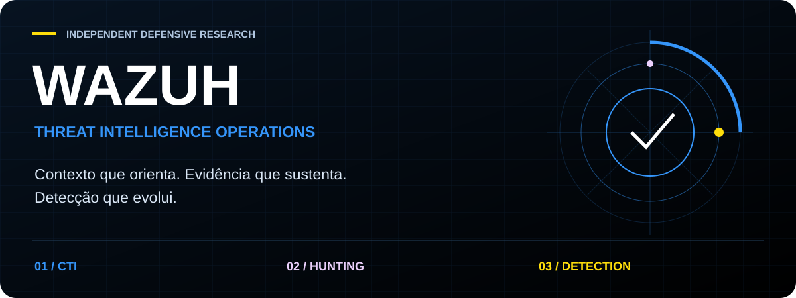
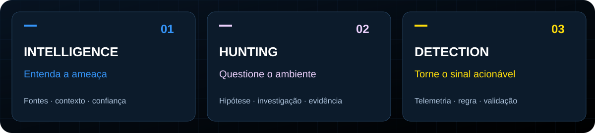
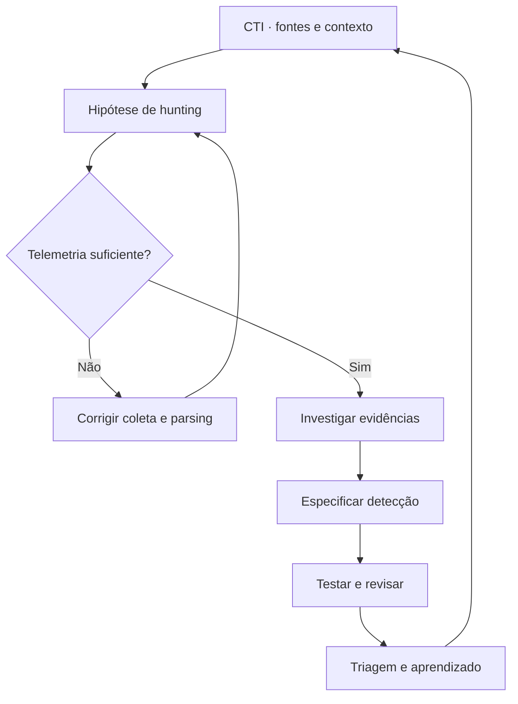

<strong>Transforme contexto em hipótese. Hipótese em evidência. Evidência em detecção.</strong>

  <a href="docs/cti.md">01 · Threat Intelligence</a> &nbsp; / &nbsp;
  <a href="docs/hunting.md">02 · Threat Hunting</a> &nbsp; / &nbsp;
  <a href="docs/detection.md">03 · Detection Engineering</a>

---

## Inteligência que chega à operação

Um espaço de engenharia defensiva em português para conectar **inteligência de ameaças, investigação orientada por hipóteses e detecções no Wazuh**. O objetivo é construir uma cadeia rastreável: fonte, comportamento, telemetria, evidência, regra e validação.

**Estado atual:** fundação documental e identidade visual. Os guias definem o fluxo de trabalho; este repositório ainda não entrega regras executáveis, integrações prontas ou um ambiente de laboratório instalado.

## Escolha sua missão

| Trilha | Pergunta operacional | Entrega esperada | Começar |
|---|---|---|---|
| **01 / CTI** | Qual ameaça é relevante para o nosso ambiente? | Brief com fontes, confiança e requisitos de coleta | [Guia de inteligência](docs/cti.md) |
| **02 / Hunting** | Que evidência sustentaria ou refutaria a hipótese? | Registro de investigação, limitações e lacunas | [Guia de hunting](docs/hunting.md) |
| **03 / Detection** | Como tornar esse comportamento observável e testável? | Especificação de regra, testes e orientação de triagem | [Guia de detecção](docs/detection.md) |

## Do contexto ao aprendizado

### Uma investigação, três entregas

**Exemplo didático: falhas de autenticação seguidas por acesso bem-sucedido.**

1. **CTI:** registrar a fonte que motivou a investigação, sua relevância e o comportamento descrito. Uma sequência de login, isoladamente, não atribui atividade a um adversário.
2. **Hunting:** investigar usuário, origem, ativo e intervalo; comparar com o baseline e considerar erros legítimos, NAT e automação administrativa.
3. **Detection:** definir os campos necessários, a janela e os critérios de agrupamento; preparar casos positivos e negativos antes de implementar uma regra.

**Resultado esperado:** uma decisão documentada, com evidências e limites. Ausência de eventos não comprova ausência de atividade.

## Contrato de qualidade

| Dimensão | Critério mínimo |
|---|---|
| Proveniência | URL, autor ou organização, data e momento da coleta |
| Confiança | Separar fato observado, inferência e hipótese |
| Telemetria | Fonte, campos, relógio, retenção e lacunas conhecidos |
| Detecção | Comportamento, pré-requisitos, falso positivo e teste negativo |
| Operação | Responsável, orientação de triagem e data de revisão |
| Validação | Evidências reproduzíveis; cobertura ATT&CK não equivale a eficácia |

## Referências de partida

- [Documentação Wazuh](https://documentation.wazuh.com/current/) — configuração e operação da plataforma.
- [Ruleset Wazuh](https://documentation.wazuh.com/current/user-manual/ruleset/index.html) — regras e decoders.
- [MITRE ATT&CK](https://attack.mitre.org/) — comportamentos adversários para orientar investigação.
- [MISP](https://www.misp-project.org/) e [OpenCTI](https://docs.opencti.io/) — referências para estruturação e gestão de inteligência.
- [Sigma](https://sigmahq.io/) — referência para especificação de detecções; conversão para Wazuh exige validação de semântica.

## Evolução planejada

- [x] Identidade visual e navegação por missão.
- [x] Guias iniciais com critérios de entrega.
- [ ] Catálogo de fontes CTI com proveniência e validade temporal.
- [ ] Hunts versionados com datasets e resultados esperados.
- [ ] Regras e decoders Wazuh com testes positivos e negativos.
- [ ] Laboratório reproduzível e validação automatizada.

## Identidade do projeto

[Sistema visual e paleta →](docs/brand.md)

Projeto independente de **Ridd1kulusC0d3r**, sem afiliação ou endosso da Wazuh. O nome Wazuh identifica a tecnologia de referência. A identidade gráfica deste repositório é própria.
