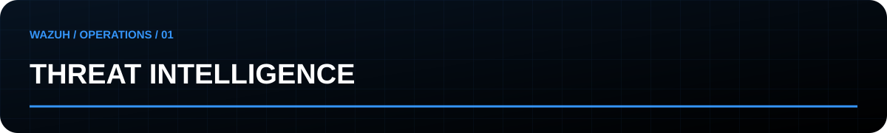

[Início](../README.md) / **01 · CTI** / [Hunting →](hunting.md)

## Transformar informação em uma pergunta investigável

Comece pela necessidade de inteligência: qual decisão será tomada, para qual ambiente e em qual prazo? Uma lista de indicadores sem contexto não responde a essa pergunta.

| Etapa | Registrar | Critério de saída |
|---|---|---|
| Direcionar | Ativos, exposição e pergunta prioritária | Decisão que a análise apoiará |
| Coletar | Fonte original, data, URL e trecho relevante | Evidência rastreável |
| Avaliar | Credibilidade, corroboração e limitações | Confiança justificada |
| Contextualizar | Comportamentos, plataformas e pré-requisitos | Relevância para o ambiente |
| Disseminar | Brief e hipótese de hunting | Próxima ação com responsável |

## Modelo de brief

```yaml
id: CTI-001
pergunta: "Há exposição ao comportamento analisado?"
escopo: "Definir ativos e intervalo"
fontes: []
data_da_analise: "AAAA-MM-DD"
fatos_observados: []
inferencias: []
confianca: "Não avaliada"
justificativa: ""
comportamentos: []
telemetria_necessaria: []
hipotese_de_hunting: ""
responsavel: ""
revisao: "AAAA-MM-DD"
```

Para indicadores, acrescente primeira e última observação, origem, validade e motivo de expiração. Não trate uma correspondência de IOC como confirmação automática de comprometimento.

**Entrega:** brief com fontes, relevância, confiança e uma pergunta que possa ser investigada. MISP e OpenCTI são referências de organização; integrações ainda não estão implementadas aqui.
