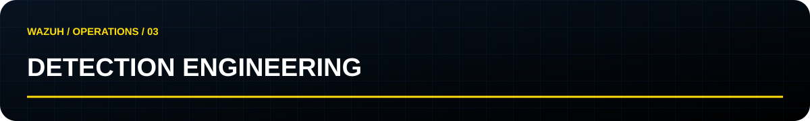

[Início](../README.md) / [← Hunting](hunting.md) / **03 · Detection**

## Converter evidência em uma detecção verificável

Defina o comportamento e a telemetria antes da sintaxe da regra. Decoders, campos e regras existentes variam conforme a fonte e a versão do ambiente: confirme-os antes de implementar XML.

| Componente | Pergunta de revisão |
|---|---|
| Objetivo | Qual comportamento precisa ser identificado? |
| Dados | Quais eventos e campos devem existir? |
| Lógica | Quais condições, agrupamentos e janelas são necessários? |
| Exceções | Quais atividades legítimas produzem sinais semelhantes? |
| Testes | Quais amostras devem disparar e quais não devem? |
| Triagem | O que o analista verificará ao receber o alerta? |
| Manutenção | Quem revisa a regra e quando? |

## Matriz mínima de validação

| Caso | Resultado esperado |
|---|---|
| Comportamento de interesse com campos completos | Correspondência conforme a especificação |
| Atividade legítima semelhante | Ausência de correspondência ou exceção documentada |
| Campo obrigatório ausente | Limitação identificada; sem conclusão indevida |
| Eventos fora da janela | Respeitar os limites definidos |
| Identidades ou origens distintas | Não correlacionar indevidamente |

Use o [`wazuh-logtest`](https://documentation.wazuh.com/current/user-manual/ruleset/testing.html) no ambiente correspondente para inspecionar parsing e regras. Testes de regra não substituem a verificação de ingestão, geração de alerta, indexação e triagem de ponta a ponta.

**Entrega:** especificação, regra quando implementada, amostras de teste, resultado obtido e runbook. Neste estágio, o repositório entrega o guia; não há ruleset certificado ou pronto para produção.
