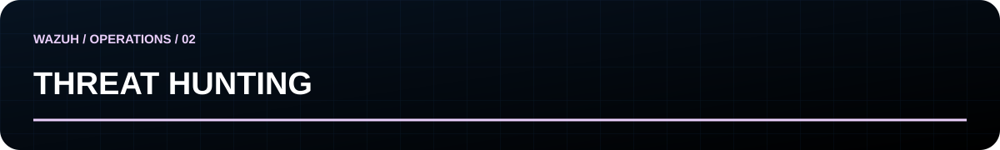

[Início](../README.md) / [← CTI](cti.md) / **02 · Hunting** / [Detection →](detection.md)

## Investigar com hipótese e critérios de refutação

**Hipótese didática:** uma sequência de falhas seguida de autenticação bem-sucedida pode revelar uso indevido de credenciais. Ela também pode refletir erro humano, mudança de senha ou automação legítima.

1. Delimite os ativos, identidades e o período da investigação.
2. Confirme ingestão, campos, timezone, retenção e integridade dos logs.
3. Identifique como sucesso e falha são representados na fonte real.
4. Agrupe por identidade e origem; investigue intervalos e contexto do ativo.
5. Compare com o comportamento habitual e busque explicações alternativas.
6. Registre os eventos de suporte e as lacunas antes de concluir.

## Registro de investigação

| Campo | O que preencher |
|---|---|
| Hipótese | Afirmação específica e testável |
| Escopo | Ativos, identidades, período e exclusões |
| Dados | Fontes, campos disponíveis e lacunas |
| Procedimento | Consulta exata, parâmetros e versão do ambiente |
| Evidências | IDs dos eventos, timestamps e artefatos preservados |
| Alternativas | Explicações legítimas consideradas |
| Resultado | Sustentada, refutada ou inconclusiva, com justificativa |
| Próxima ação | Coleta, detecção, revisão ou encerramento |

**Entrega:** registro reproduzível. Se a fonte necessária não foi coletada, o resultado é limitado pela telemetria; não declare que o comportamento não ocorreu.

Uma descoberta recorrente pode gerar uma especificação de detecção. Uma consulta exploratória não deve virar alerta de produção sem teste e revisão.
