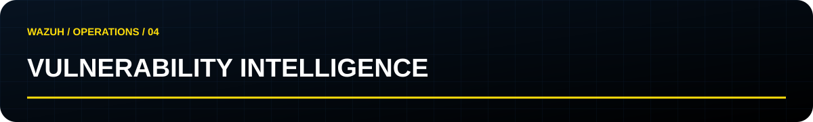

[← Catálogo CVE](../README.md) · [Fontes](sources.md) · [Validação](validation.md) · [Pacote original](../../../vendor/php2shell/README.md)

# PHP2Shell · detecção em camadas

**Revisão: 23/10/2026. Estado: análise documental e estática; sem execução local de Wazuh.**

## Contexto confirmado

O PHP identifica **CVE-2026-109618** como corrupção associada a OOM e **CVE-2026-109619** como estado global obsoleto. O pré-anúncio atribui **CVSS v4.0 9.2** aos dois. As correções upstream são **8.2.35, 8.3.36, 8.4.27 e 8.5.12**; distribuições podem aplicar backports. Verifique o pacote do fornecedor, não apenas `php -v`. [PHP](sources.md#fontes-primárias)

**Atualização de 23/10:** o PHP orienta desabilitar `session.upload_progress.enabled` diante de um vetor residual sob uma combinação específica: configuração inicial `php_binary`/`php_serialize`, troca para `php` em runtime e chamada a `session_start()`. O comunicado associa o acompanhamento a **CVE-2026-115560**. Aplicações que não alteram o handler em runtime podem manter a funcionalidade, segundo o PHP. Isso exige revisão separada mesmo após a correção dos dois CVEs originais. [Comunicado PHP](https://www.php.net/archive/2026.php)

## O que foi incluído

Snapshot MIT do projeto de **Kislley Rodrigues (m0us3r)**, sem alterações na lógica: regras, decoders, política SCA e configuração Apache. O pacote e seus hashes estão em [vendor/php2shell](../../../vendor/php2shell/README.md). A validação relatada pelo autor usa Wazuh 4.14.8, Ubuntu 24.04, PHP 8.3 e Apache mod_php; não foi reproduzida nesta inclusão.

| Regra | Sinal | Limitação / falso positivo |
|---|---|---|
| 100100 | Erro fatal de limite de memória PHP | Aplicação legítima também esgota memória |
| 100101 | Repetição de OOM pela mesma origem | NAT/proxy pode agregar clientes; depende de `srcip` |
| 100110 | Segfaults repetidos de workers Apache | Extensões defeituosas; sem origem de cliente |
| 100120 | HTTP 500 repetido pela mesma origem | Bugs e indisponibilidade legítima |
| 100130 | Multipart com transferência chunked | Sinal HTTP/1.1; não cobre HTTP/2 sem comprimento |
| 100131 | PHPSESSID com codificação percentual ou tamanho elevado | Formato customizado pode ser legítimo; não prova vazamento |

As correlações usam as regras nativas **30301, 30304 e 31122**: confirme o SID final no seu ruleset. Confira colisões dos IDs 100100–100131 antes de instalar. T1190 é contexto de investigação; a presença da tag ATT&CK não prova exploração.

## Exposição e postura

A SCA contém os checks 109600–109604, específicos para Ubuntu 24.04/PHP 8.3/mod_php. O check de pacote usa uma expressão de revisão Ubuntu, não um comparador universal de versões. Não aplicar a Debian, RPM, builds próprios ou PHP-FPM sem adaptação e teste.

**Ressalva de revisão:** o snapshot permite que o backport faça os checks de mitigação passarem. Portanto, um score de 100% não avalia sozinho a condição residual do comunicado de 23/10. Registrar separadamente SAPI em execução, configurações por pool/vhost e mudanças de handler feitas pela aplicação.

Consultar arquivos Apache via PHP CLI não reproduz todo o contexto de uma requisição. Includes externos, configurações de aplicação e caminhos fora do escopo podem escapar da política. `memory_limit=-1` é uma medida temporária descrita nas fontes, com impacto de disponibilidade; não é uma configuração padrão recomendada por este projeto.

## Hunting comportamental complementar

A [regra Sigma de rjmendez](sources.md#referências-complementares) está experimental. Sua condição aceita **usuário OU processo pai**, combinados com texto de comando; portanto pode corresponder a atividades sem pai PHP. Uso de `contains` em linha de comando também pode capturar argumentos sem execução da ferramenta citada. Aqui ela é referência de investigação, não conversão automática para XML.

Proposta de hunt: identificar processo filho incomum de PHP/Apache, obter caminho do executável, pai, usuário e horário; correlacionar com requisições, arquivos alterados e destinos de rede. Revisar jobs legítimos e funções da aplicação que executam ferramentas.

A Elastic organiza a cobertura comportamental por processos e arquivos. Essa abordagem complementa os sintomas HTTP; não transporta automaticamente as capacidades de Elastic Defend para Wazuh. Execução em memória ou outros caminhos podem não produzir os sinais esperados. [Elastic](sources.md#referências-complementares)

## Privacidade e operação

O LogFormat original registra **Set-Cookie completo**. `no_full_log` limita o alerta, mas não elimina o conteúdo do arquivo Apache ou dos archives se habilitados. Mesmo o prefixo de oito caracteres extraído pelo decoder pode conter dados sensíveis. Avalie acesso e retenção antes de habilitar; prefira derivar características sem persistir valores quando houver pipeline apropriado. Essa alternativa ainda não está implementada neste pacote.

## Mitigação e triagem

Priorize correção do PHP e confirme os workers efetivamente recarregados. A AWS apresenta controles de WAF para reduzir exposição, com limites de inspeção: eles não corrigem a falha no runtime. Avalie em Count, confira uploads legítimos e só depois considere Block. [AWS](sources.md#referências-complementares)

Ao investigar: preserve eventos e versão de pacote; alinhe relógios; correlacione host/vhost/origem; busque execução, alterações e conexões; registre explicações alternativas. Um alerta isolado deve ser tratado como sinal a investigar. A ausência de alerta pode representar lacuna de coleta, parsing ou cobertura.
